<p align="center">
  <picture>
    <source media="(prefers-color-scheme: dark)" srcset="public/logo.svg">
    
  </picture>
</p>

<p align="center">
  A pantry-first grocery and meal planner for Indian home cooks.<br>
  Plan your week with real recipes, build a grocery list that skips what you already have,<br>
  and see live mandi (wholesale market) prices from data.gov.in.
</p>

<p align="center">
  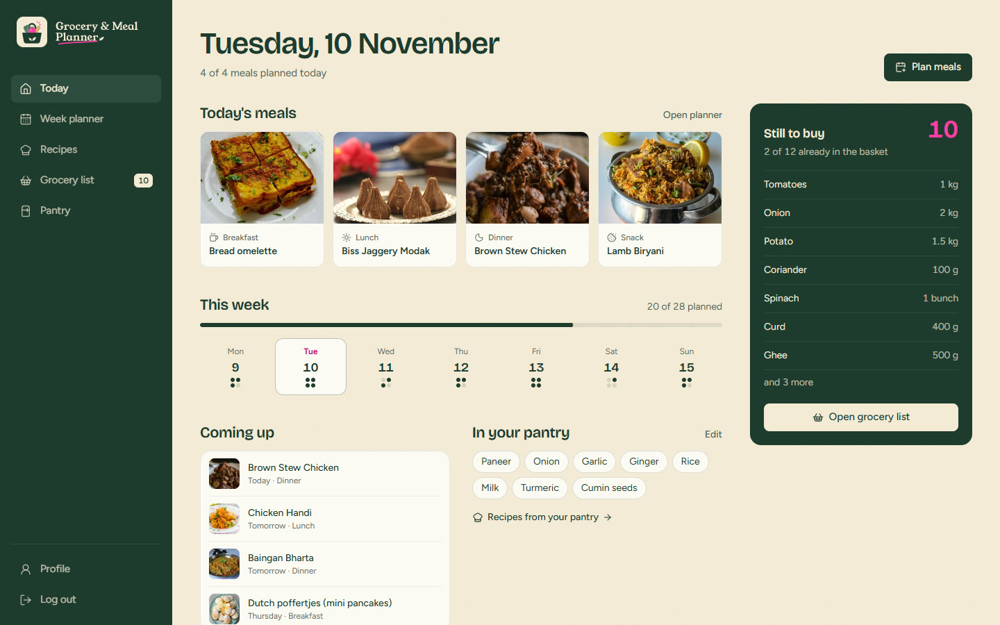
</p>

## What it does

Most recipe apps start from recipes and most list apps start from an empty list. This one starts from your kitchen:

1. **Pantry**: note what you already have at home.
2. **Recipes**: get dishes that use it, ranked by how many of your pantry items each one uses.
3. **Week planner**: put meals into breakfast, lunch, dinner and snack slots for each day.
4. **Grocery list**: add a recipe's or the whole week's ingredients in one tap; anything already in your pantry is left off.

### Features

| Area | What you can do |
|---|---|
| **Today (dashboard)** | Today's four meal slots, the week's progress, upcoming meals, what is still to buy and your pantry at a glance |
| **Week planner** | A weekly ledger (days as columns, meals as rows) on desktop and a day-by-day view on phones; search recipes or pick from pantry-based suggestions for any slot; move between weeks; add the whole week's ingredients to the grocery list |
| **Recipes** | Recipes built from your whole pantry or a single ingredient, a vegetarian / non-vegetarian filter, and a detail page with ingredients (pantry items marked), step-by-step method and the video tutorial |
| **Grocery list** | Items grouped by category with quantity and unit; add, edit, remove and check off (a pink ink stroke crosses the item out and files it under "In the basket"); progress bar and "clear basket" |
| **Market prices** | For loose staples (onion, tomato, dal, ghee and around 40 more), the day's mandi price from data.gov.in: price per kg, the market and state, date and a freshness marker, with an estimated cost when the quantity is in g or kg |
| **Product search** | Indian packaged products from Open Food Facts (photo, brand, size), added to the list in one tap |
| **Pantry** | Items grouped by category with quick-add suggestions and a "recipes with this" shortcut |
| **Profile and sign-in** | Email and password accounts with Firebase Authentication; name, diet preference, allergies and usual food type saved in Firestore |

The interface works on desktop, tablet and phone, supports keyboard navigation with visible focus, and respects the operating system's reduced-motion setting.

## Screenshots

| Week planner | Recipes |
|---|---|
| 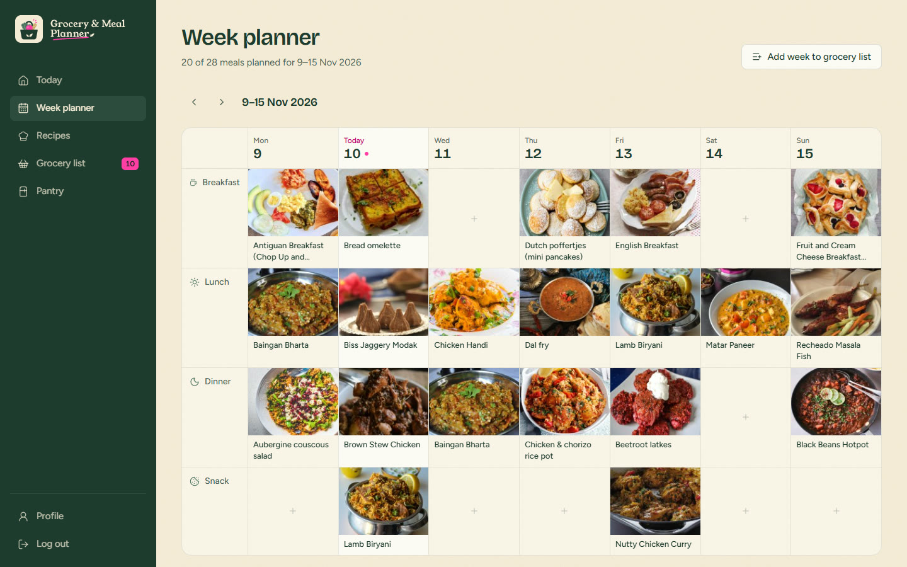 | 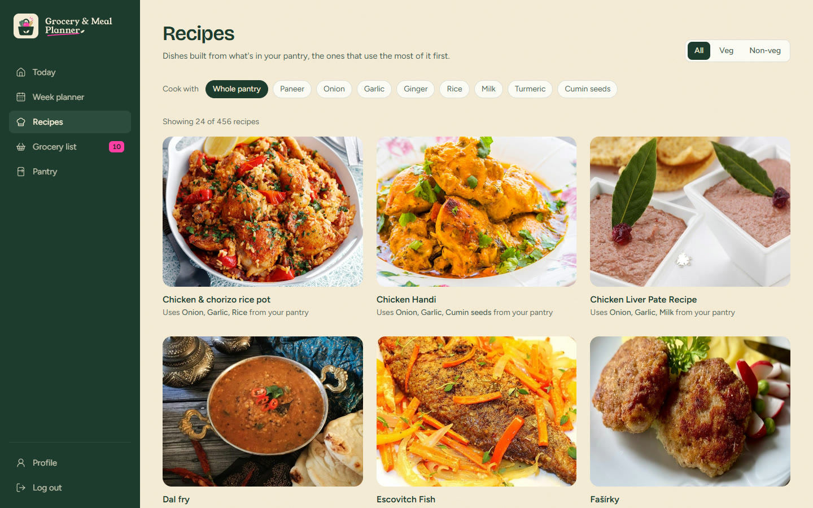 |
| **Recipe detail** | **Grocery list with market prices** |
| 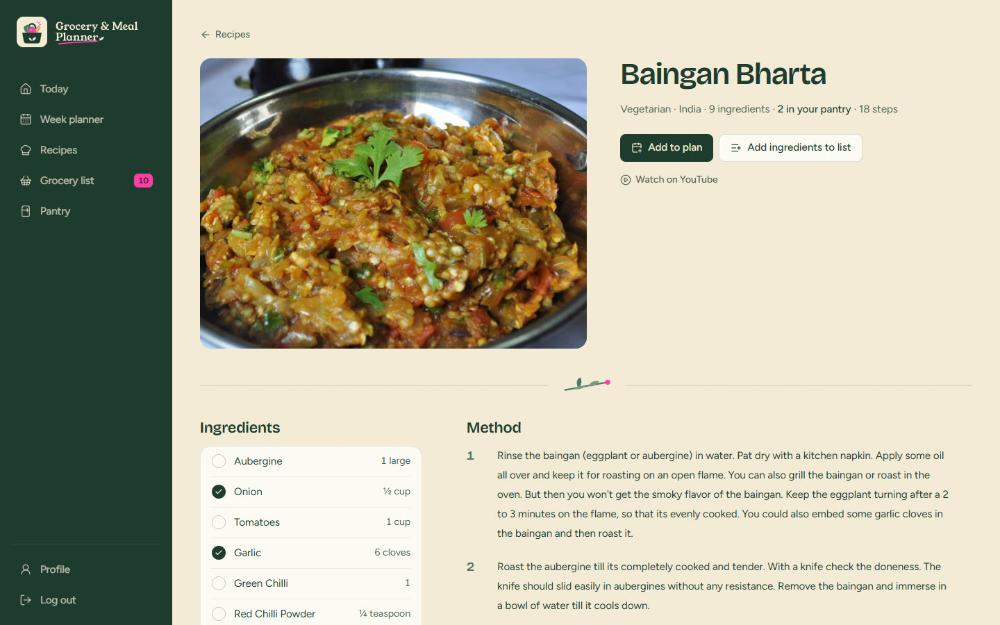 | 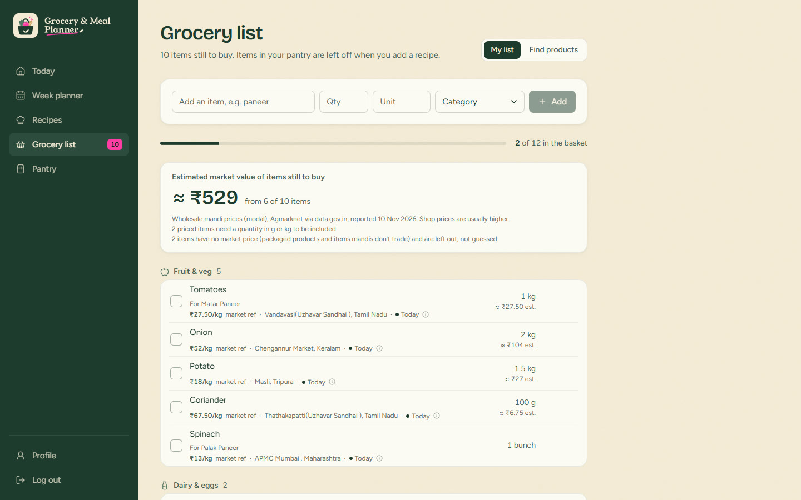 |
| **Product search** | **Pantry** |
| 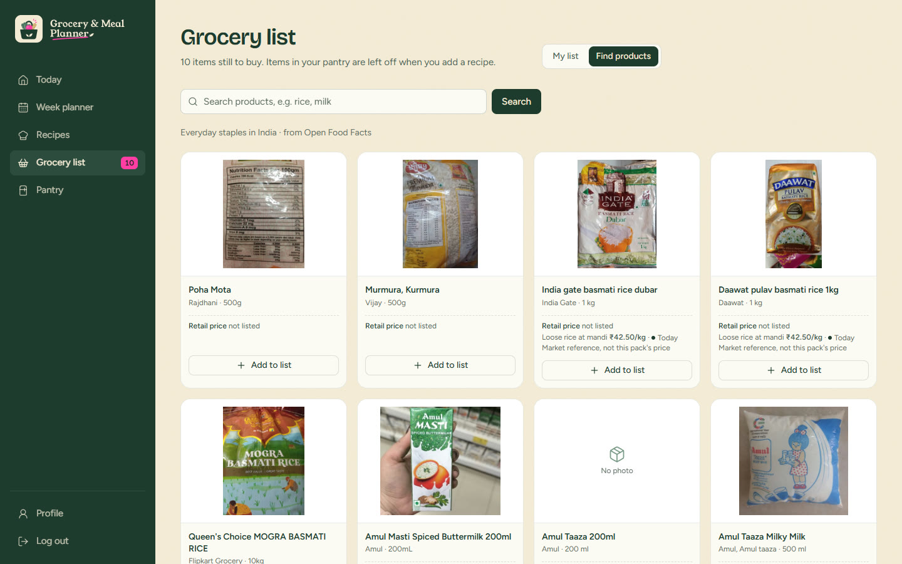 | 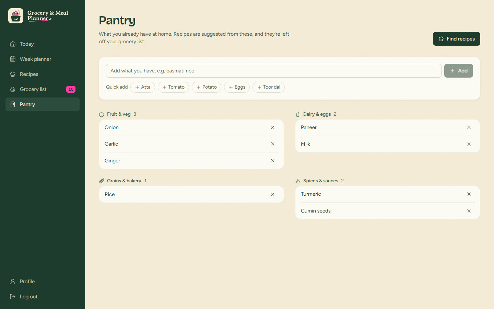 |

<p align="center">
  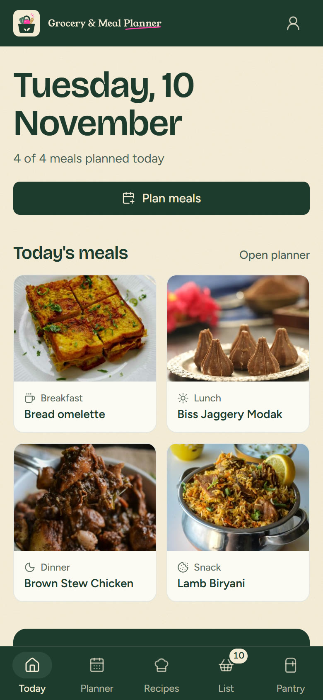
  &nbsp;
  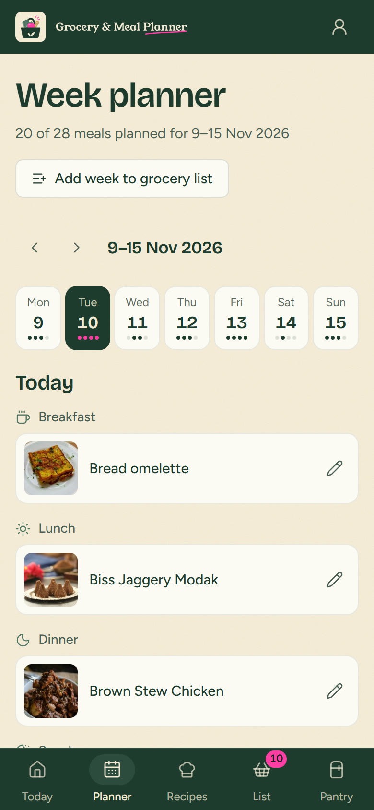
  &nbsp;
  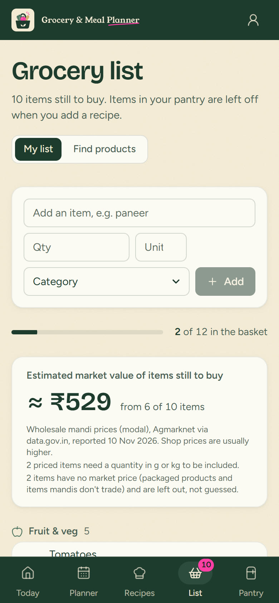
</p>

<details>
<summary>Sign-in screen and the market price details panel</summary>

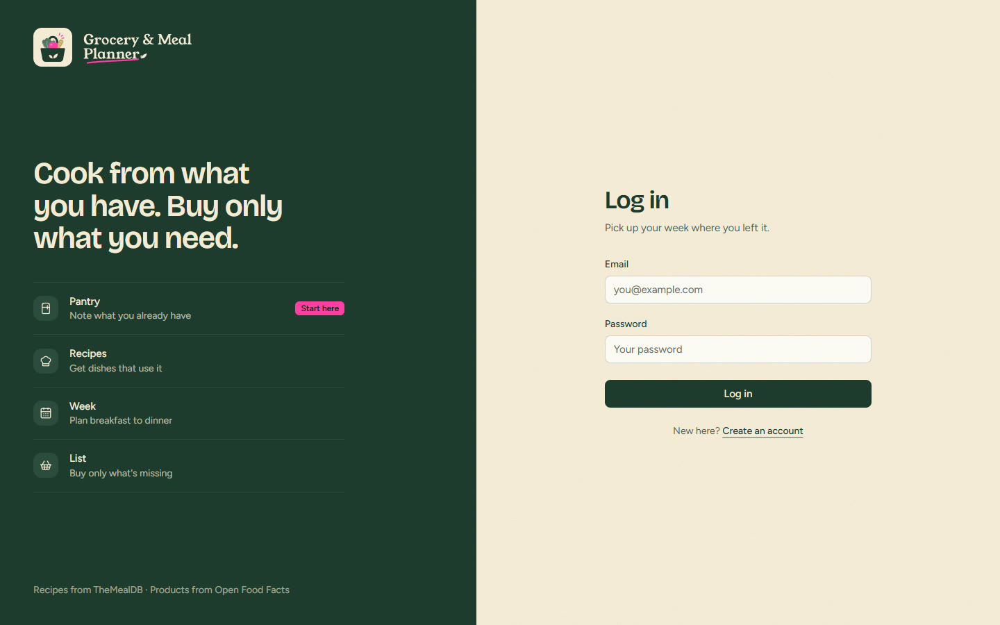

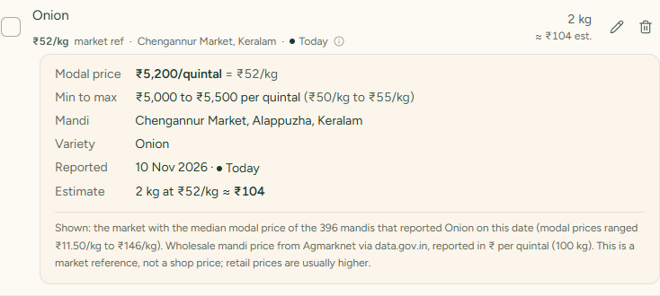

</details>

## How market prices work

Prices come from the Government of India's open data API, dataset *Current Daily Price of Various Commodities from Various Markets (Mandi)* (Agmarknet, Ministry of Agriculture and Farmers Welfare).

- **What is shown**: hundreds of mandis report each commodity every day. The app shows the market whose modal price is the median that day, with that market's minimum and maximum price, the date and how many mandis reported.
- **Units**: Agmarknet reports rupees per quintal (100 kg). The app converts to rupees per kg.
- **Estimates**: calculated only when an item's quantity is a weight (g or kg). Items in litres, pieces, bunches or packs show the market price without an estimate.
- **What never gets a price**: packaged and branded products, items mandis do not trade (paneer, milk, eggs) and items that are not the mandi commodity (atta is not wheat; "basmati rice" is a variety). Nothing is guessed.
- **It is a market reference, not a shop price.** Retail prices are usually higher, and the app labels prices that way.

## Tech stack

- [React 19](https://react.dev) with [Create React App](https://create-react-app.dev), [React Router 7](https://reactrouter.com)
- [Tailwind CSS 3](https://tailwindcss.com) with project design tokens (`tailwind.config.js`)
- [Firebase](https://firebase.google.com) Authentication and Cloud Firestore
- [Framer Motion](https://motion.dev) for the few state animations, [Lucide](https://lucide.dev) icons
- Fonts: Bricolage Grotesque (headings) and Figtree (text), self-hosted through Fontsource
- Data: [TheMealDB](https://www.themealdb.com), [Open Food Facts](https://world.openfoodfacts.org), [data.gov.in](https://www.data.gov.in)

Pantry items, the meal plan and the grocery list are stored in the browser (`localStorage`), so they stay on the device where you created them.

## Getting started

### Prerequisites

- [Node.js](https://nodejs.org) 18 or newer and npm
- A free [Firebase](https://console.firebase.google.com) project
- A free [data.gov.in](https://www.data.gov.in) account (for market prices; the app works without it)

### 1. Install

```bash
git clone https://github.com/<your-username>/<repo-name>.git
cd <repo-name>
npm install
```

### 2. Configure environment variables

Copy the template and fill in your own values:

```bash
cp .env.example .env.local
```

| Variable | Where to find it |
|---|---|
| `REACT_APP_FIREBASE_*` (6 values) | Firebase console › Project settings › Your apps › Web app config |
| `REACT_APP_DATAGOV_KEY` | data.gov.in › sign in › My Account › API key |
| `REACT_APP_SPOONACULAR_KEY` | Optional, not used yet |

`.env.local` is git-ignored. Never commit real keys. Restart `npm start` after editing it.

### 3. Set up Firebase

1. **Authentication** › Sign-in method › enable **Email/Password**.
2. **Firestore Database** › create a database.
3. **Firestore** › **Rules**: let each signed-in user read and write only their own profile, then **Publish**:

   ```
   rules_version = '2';
   service cloud.firestore {
     match /databases/{database}/documents {
       match /profiles/{userId} {
         allow read, write: if request.auth != null && request.auth.uid == userId;
       }
     }
   }
   ```

   Without these rules, sign-in still works but profiles cannot be loaded or saved.

### 4. Run

```bash
npm start
```

Open [http://localhost:3000](http://localhost:3000) and create an account.

### Scripts

| Command | What it does |
|---|---|
| `npm start` | Development server with hot reload |
| `npm run build` | Production build in `build/` |
| `npm test` | Jest test runner (watch mode) |

## Project structure

```
public/                 index.html, manifest, favicon and logo assets
src/
  App.js                routes; every page except /login requires sign-in
  firebase.js           Firebase setup (reads .env.local)
  components/           pages: Home (dashboard), Planner, MealSuggestions (recipes),
                        MealDetail, GroceryList, Pantry, ProfilePage, Login, AppShell
  ui/                   shared components (buttons, inputs, dialog, toast, brand, illustrations)
  lib/                  data and logic: storage, dates, meals, grocery, market prices
  __tests__/            Jest tests
docs/screenshots/       README images
PRODUCT.md, DESIGN.md   product notes and the design system (colours, type, components)
```

## Tests

```bash
CI=true npx react-scripts test --watchAll=false
```

- `marketPrices.test.js` (10 tests) and `mealSteps.test.js` (3 tests) pass. They cover matching list items to mandi commodities, unit conversion, choosing the median market from a real API response, freshness, and splitting recipe instructions into steps.
- The older `App.test.js`, `__tests__/App.test.js` and `__tests__/login.test.js` currently fail (a duplicate import, an ambiguous text query and the leftover Create React App example test) and need updating.

## Known limitations

- Pantry, plan and grocery list are saved per browser and do not sync between devices.
- data.gov.in is sometimes slow or refuses requests; the app retries, then shows "Try again". Prices are cached for six hours.
- Market prices are wholesale mandi references, not shop prices, and only cover loose staples.
- TheMealDB has a limited set of Indian recipes. A Spoonacular integration is planned.

## Credits and data licences

- Recipes and photos: [TheMealDB](https://www.themealdb.com)
- Product data: [Open Food Facts](https://world.openfoodfacts.org), under the Open Database License
- Market prices: [data.gov.in](https://www.data.gov.in) / Agmarknet, under the Government Open Data License – India
- Fonts: Bricolage Grotesque, Figtree and Young Serif (logo wordmark), all under the SIL Open Font License 1.1
- Icons: [Lucide](https://lucide.dev), ISC License

## Author

Built by Aareen Mhatre.
